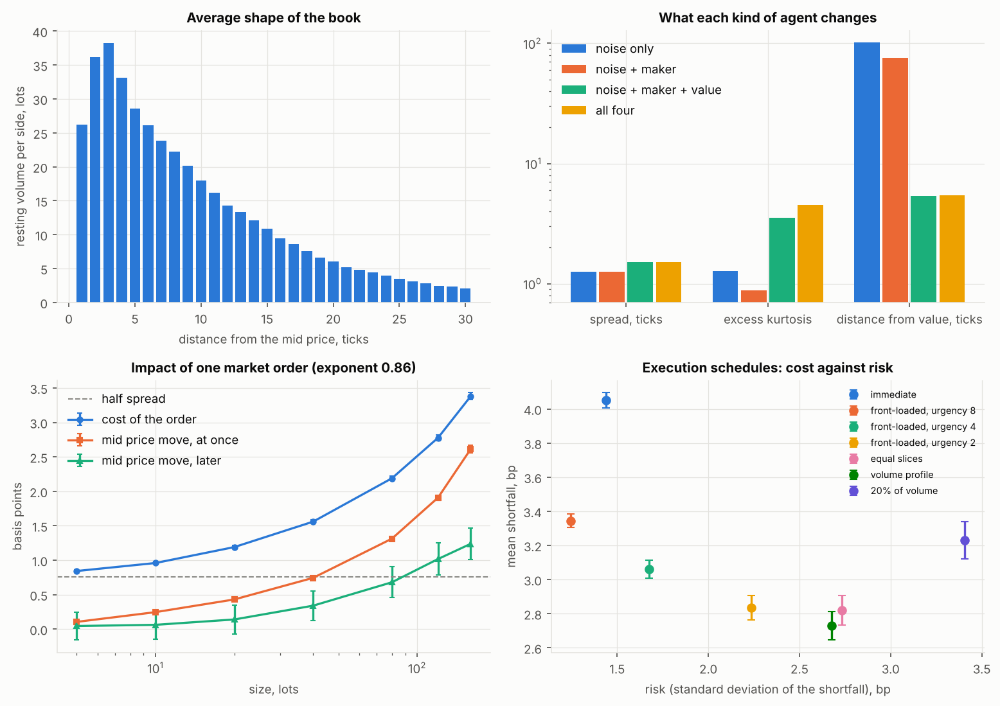

# LobSim

A limit order book exchange in Rust, a small population of trading agents on top of it, and execution schedules run against the resulting market. No dependencies.

The point is a laboratory where execution questions have measurable answers: what does one market order cost as a function of its size, and what do you buy, in cost and in risk, by slicing an order over time.

## What is inside

| Layer | Modules | Content |
|---|---|---|
| `book` | `orderbook`, `matching`, `level`, `snapshot`, `naive` | price-time priority matching for limit, market and cancel, consistency checks, and a second, list-scanning book used only as a reference |
| `agents` | `noise`, `maker`, `momentum`, `value` | random order flow, a quoting market maker with inventory skew, a trend follower, a trader anchored to a fundamental value |
| `sim` | `market`, `metrics`, `params` | the step loop, fill notifications, the tape, summary statistics |
| `exec` | `immediate`, `twap`, `frontloaded`, `vwap`, `pov`, `runner` | schedules behind one trait, and the runner that measures implementation shortfall |
| `math` | `rng`, `stats` | xoshiro generator, descriptive statistics |

Python (`src/lobsim`) drives the binary and writes the report.

## Results

One tick is one basis point (bp). Full tables in `reports/report.md`.

**Matching engine.** 50,000 random orders give exactly the same 28,436 trades as the reference book, with the internal consistency check passing after every order. Throughput is roughly 0.7 million orders per second on one core, in a stress test that leaves half a million orders resting.

**Each agent has a visible job.**

| | noise only | + maker | + value | + momentum |
|---|---|---|---|---|
| Distance of the price from the fundamental value, ticks | 101 | 76 | 5.4 | 5.5 |
| Variance ratio over 50 steps (1 is a random walk) | 0.56 | 0.59 | 1.17 | 1.18 |
| Excess kurtosis of 50-step price changes | 1.3 | 0.9 | 3.5 | 4.5 |
| Autocorrelation of order-flow sign | -0.01 | 0.00 | 0.15 | 0.15 |

Random flow alone gives a mean-reverting price with no anchor. The value trader ties it to the fundamental value and, as a side effect, produces persistent order flow and fat tails.

**Impact of one market order.** The cost starts at the half spread (0.84 bp for 5 lots against 0.76) and reaches 3.4 bp for 160 lots. Above the half spread it grows as size to the power 0.86. After 200 steps, 47% of the immediate move of the mid price is still there for the largest order.

**Execution schedules**, 200 lots over 200 steps, 4,000 independent markets each:

| Schedule | Cost, bp | Risk, bp |
|---|---|---|
| Immediate | 4.05 | 1.44 |
| Front-loaded, urgency 8 | 3.34 | 1.25 |
| Front-loaded, urgency 4 | 3.06 | 1.67 |
| Front-loaded, urgency 2 | 2.84 | 2.24 |
| Equal slices | 2.82 | 2.73 |
| Volume profile | 2.73 | 2.68 |
| 20% of volume | 3.23 | 3.41 |

Standard errors of the cost are 0.02 to 0.05 bp. Two things stand out. The front-loaded family traces the expected frontier, cheaper and riskier as urgency falls. And trading everything at once is not on it: spreading the order over the first few dozen steps is both cheaper and less risky, because the risk of an immediate order is the variability of the book it hits.



## Reading the numbers

- This is a simulated market. The numbers describe this population with these parameters, they are not estimates for any real instrument.
- The impact exponent of 0.86 is far from the square root reported for real markets. The book here refills at random and nobody hides or splits orders, so there is little to make impact concave. The exponent is a property of the model, not a finding about markets.
- The fundamental value is a random walk given from outside, and the value trader sees it exactly. It makes 0.5 tick-lots per step at the expense of the noise flow, the maker and the trend follower lose slightly. Nothing here says anything about profitable strategies.
- Schedules use market orders only. Passive execution with limit orders, which is how most real slicing is done, is not implemented.
- The percentage-of-volume schedule is the worst of the set here, since it reacts to volume that it partly creates and completes the remainder in the last step.
- Orders of 120 and 160 lots could not be filled completely in 1 and 6 of 2,000 markets, those runs are left out of the impact averages.
- No self-trade prevention, no latency, no fees, one instrument.
- The throughput figure includes order generation and is a single informal measurement.

## Run it

```
pip install -e ".[dev]"
make build      # cargo build --release
make test       # cargo test, then pytest
make run        # writes reports/
```

From Rust:

```rust
use lobsim::exec::{runner::execute, twap::Twap};
use lobsim::sim::{market::Market, params::Params};
use lobsim::Side;

let mut market = Market::standard(&Params::default(), 1);
let report = execute(&mut market, Side::Buy, 200, 200, &Twap);
println!("{:.2} bp", report.shortfall_bps);
```

Examples: `cargo run --release --manifest-path engine/Cargo.toml --example book_demo` (also `run_market`, `compare_schedules`).
From the shell: `engine/target/release/lobsim execute schedule=frontloaded urgency=4 seeds=1000`, or `python scripts/frontier.py`.

## Layout

```
engine/src/        book, agents, sim, exec, math and the command line binary
engine/tests/      integration tests, one file per subject
engine/examples/   three short programs
src/lobsim/        Python driver, report and figure
configs/           sizes of the experiments
docs/              design and methods
reports/           report, validation table, metrics, figure
```

## Author

Amir Masominia. PhD in physics (Université Paris-Saclay); postdoctoral researcher working on machine-learning surrogate models, numerical simulation and automated measurement pipelines.

MIT licence.
